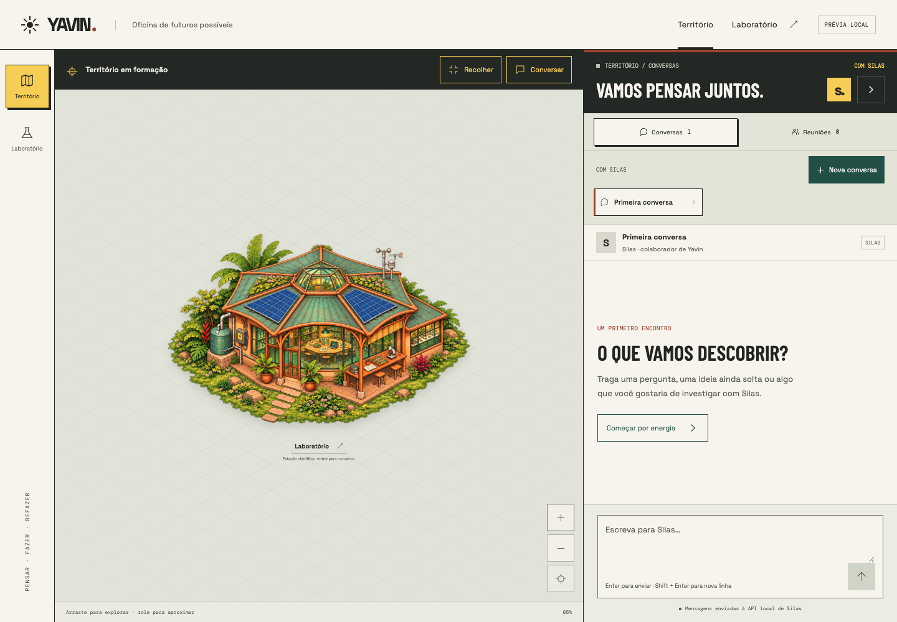
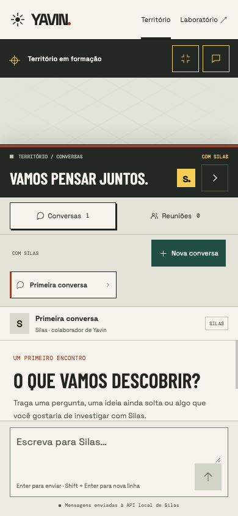

# Chat integrado ao mapa

**Natureza:** decisão provisória de interface e referência visual.  
**Estado:** implementada; direção futura de comandos ainda sem contrato técnico.

Data: 05 de novembro de 2026  
Questão: conversar com agentes sem sair do mapa, preparando a possibilidade de
acompanhar efeitos de comandos no território.  
Opções consideradas: manter apenas o laboratório dedicado, criar outro chat
independente no mapa ou reutilizar o mesmo painel em um drawer.  
Decisão: reutilizar uma única instância do painel, com apresentação de drawer
recolhível no mapa normal e expandido. O laboratório dedicado continua disponível.  
Motivo: manter continuidade da conversa e acesso ao território na mesma área de
trabalho, sem duplicar históricos, rascunhos ou requisições.  
O que continua aberto: agente Engenheiro, vocabulário e contrato de comandos,
execução de ações, retorno de eventos e eventual aprovação das mudanças.  
Próximo passo: avaliar o uso conjunto do mapa e do chat antes de definir a integração
de ações com o backend, que permanece sob responsabilidade do Idealizador.

## Comportamento implementado

- O botão Conversar no cabeçalho do mapa abre e recolhe o drawer.
- No desktop, mapa e chat ficam lado a lado. No tablet, o drawer abre lateralmente;
  no celular, pela parte inferior, ocupando a altura disponível em janelas baixas.
- O mapa mantém câmera, zoom e controles. Não há bloqueio modal do restante da tela.
- Abertura transfere o foco ao painel; Fechar ou Escape recolhe e devolve o foco ao
  controle. Com ambos abertos, Escape recolhe primeiro o chat.
- A mesma instância de conversa atende às duas rotas. Seleção, rascunhos, histórico
  e respostas em andamento permanecem ao recolher ou navegar para o laboratório.
- O envio continua usando a API atual de Silas; reuniões permanecem locais.

## Verificação

Build TypeScript/Vite concluído. No Ego Browser, verificados abertura, fechamento,
Escape, foco, câmera interativa com chat aberto, seleção e rascunho entre as duas
rotas e recebimento de resposta com o drawer recolhido. A resposta foi controlada
no navegador; nenhum modelo foi chamado. Dados locais de QA foram restaurados.

Drawer e compositor verificados em 1440 × 1000, 1024 × 768, 768 × 1024, 390 × 844,
320 × 568, 390 × 500 e 740 × 360, sem overflow horizontal ou corte do compositor.
O teclado virtual foi representado por uma janela de altura reduzida, sem teste
em aparelho físico.

## Capturas

