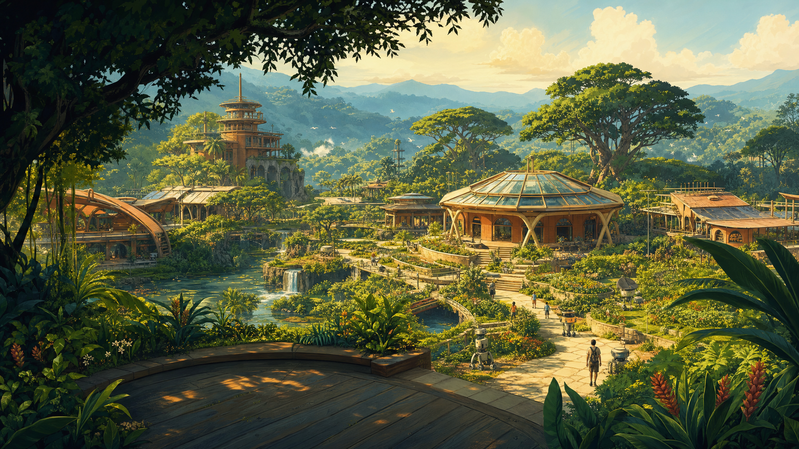
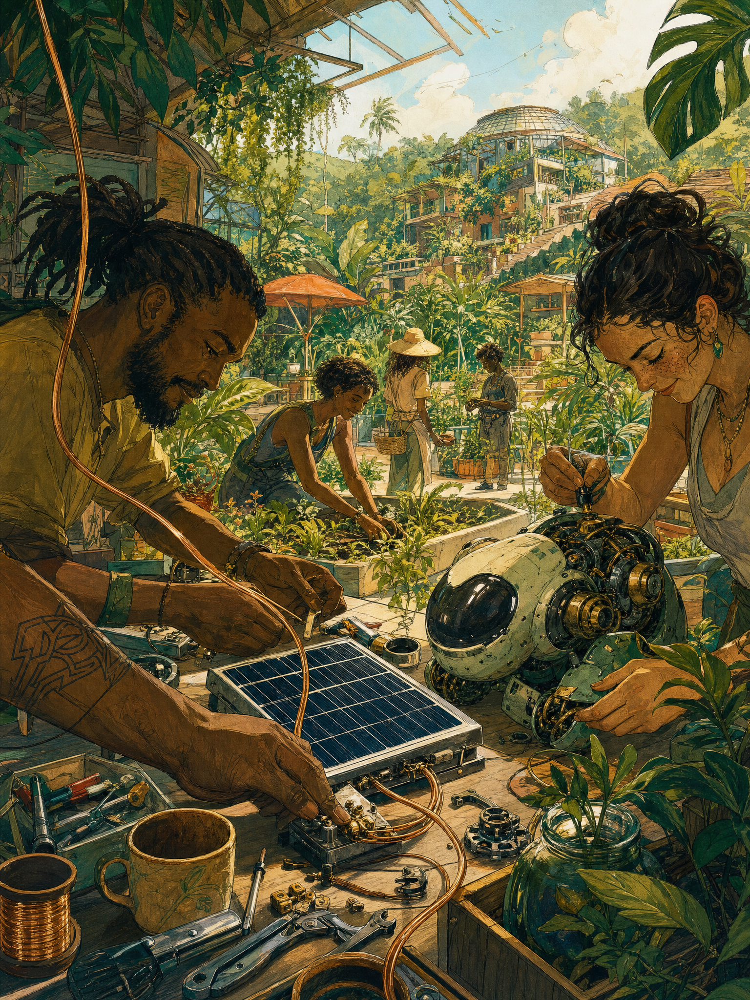

# Direção artística de Yavin — ilustração solarpunk

**Natureza:** orientação artística de desenvolvimento e repertório de referências visuais; não integra a base de conhecimento da simulação.
**Data:** 08/11/2026.
**Estado:** paisagem de chegada e arte do topo do manifesto aprovadas pelo Idealizador como âncoras da identidade artística; direção estendida às futuras implementações no mapa.

Data: 08/11/2026.
Questão: estabelecer uma linguagem artística para a chegada e para a evolução visual do mapa.
Opções consideradas: paisagem ilustrada, arquitetura orgânica, objetos tecnológicos expressivos e referências brasileiras de integração entre arquitetura e vegetação.
Decisão: seguir a direção da paisagem de chegada v1 e da arte do manifesto v1, aprovadas pelo Idealizador; manter as referências abaixo como repertório para imagens, objetos, robôs e futuras artes do mapa. Preservar a essência que está se formando.
Motivo: ilustração acolhedora, fresca e expressiva, capaz de combinar tecnologia, vida cotidiana e imaginação solarpunk.
O que continua aberto: futuras referências trazidas pelo Idealizador e aplicação incremental desta linguagem às artes do mapa.
Próximo passo: consultar este repertório ao propor novas artes para Yavin.

## Âncora visual aprovada

Ilustração panorâmica de uma comunidade em vale tropical: vegetação em camadas,
terraço sombreado, estação científica, oficinas, caminhos, água, pessoas e pequenos
robôs utilitários. Luz quente, verdes profundos, madeira, terracota e metais com
aparência tátil. Profundidade e inventividade dos objetos são parte da direção.

A paisagem representa um futuro imaginado. O lugar real de Yavin continua aberto.
O mapa existente ainda usa a estação v3 e o personagem pixelado; a evolução dessas
artes será incremental, usando esta direção como referência.

### Arte do manifesto aprovada

O Idealizador destacou a arte do topo do manifesto como bonita e inspiradora,
afirmando que estamos construindo a identidade e direção artística desejadas:
“Não vamos perder a essência!”. Esta aprovação soma-se à paisagem da chegada.
O trabalho compartilhado, as pessoas e os robôs em meio à vegetação, o traço,
as texturas e a relação entre tecnologia e vida cotidiana orientam novas propostas.

[Registro da página e procedência da arte](manifesto/README.md) ·
[Prompt do manifesto](manifesto/arte-v1.prompt.txt).

## Linguagem do universo visual

Estas orientações descrevem as qualidades aprovadas nas duas imagens, para apoiar
novas propostas. São uma direção artística, não uma decisão sobre como a comunidade
real ou simulada será organizada.

- **Paisagens e lugares:** cenas com primeiro plano, caminhos e horizonte; edifícios
  em escala humana entre vegetação, água e espaços de convivência. A natureza participa
  da composição e não é apenas um fundo decorativo.
- **Arquitetura e materiais:** oficinas e estações acolhedoras; madeira, terracota,
  metal e vidro com presença tátil. Formas inventivas devem parecer utilizáveis e
  relacionadas às atividades do lugar.
- **Pessoas e personagens:** a oficina do manifesto mostra trabalho compartilhado,
  cuidado e diversidade. O mapa atual contém Silas; novas pessoas e atividades em
  uma arte imaginada não são evidência de habitantes ou eventos reais da simulação.
- **Tecnologia e objetos:** robôs, ferramentas e infraestrutura têm uma função
  reconhecível, detalhes expressivos e relação com o cotidiano e com o ambiente.
- **Luz e cor:** luz solar acolhedora, sombras vegetais, verdes variados, azul-verde
  em profundidade, tons terrosos, creme e dourado. É uma família visual, não uma
  paleta de valores fixos ou exigência de repetir a mesma cena.
- **Traço e composição:** ilustração expressiva com textura de pintura, silhuetas
  claras e detalhes que recompensam a observação. A cena precisa respirar: poucos
  textos na chegada e interações visualmente ligadas ao ambiente.
- **Movimento e som:** gestos discretos podem reforçar curiosidade e contemplação.
  Respeitar movimento reduzido e oferecer controle de som; a ambiência atual é um
  experimento, não uma trilha definitiva aprovada.

### Movimento da paisagem — direção aprovada

O Idealizador pediu animações básicas e discretas que preservem **todos os elementos
da paisagem aprovada**. A imagem estática continua sendo o original de referência.
Ele aprovou visualmente o resultado de água, luz e lente em 08/11:

1. Reflexos suaves na água e pequena cachoeira animada.
2. Variação leve de luz e reflexos segmentados nos vidros do telhado.
3. Movimento mínimo em folhas do primeiro plano permanece uma possibilidade para
   discussão; não foi implementado nem aprovado.

Camadas locais preservam o arquivo original; a imagem exibida com efeitos pode mudar
visualmente durante a animação. Vídeo gerado a partir da imagem pode redesenhar ou
alterar detalhes entre quadros, portanto não garante a preservação integral: qualquer
teste exige comparação visual antes de uso, arquivo separado e possibilidade de
retornar ao original. O parallax atual já movimenta a imagem como um único plano.
Os efeitos são desenhados por `frontend/src/arrivalEffects.ts` em canvas transparente,
sem geração de vídeo. O mesmo quadro aparece na cena, na lupa e na ocular 3D.
A lente sugere convexidade pelo acabamento, mantendo a paisagem observada sem
distorção. Os efeitos são ocultados quando o visitante prefere movimento reduzido.
[Registro](chegada/README.md).

## Repertório preservado

| Referência | Contribuição para Yavin |
| --- | --- |
| [Dear Alice — THE LINE](https://thelinestudio.com/work/chobani) | Atitude da ilustração, natureza, tecnologia e vida cotidiana. O Idealizador destacou a força artística do estúdio. |
| [Conceitos de objetos e máquinas — Braydan Barrett](https://braydanbarrett.artstation.com/projects/5XDNnz) | Identidade de objetos e robôs, tecnologia expressiva e funcional. |
| [Vegetal City — Luc Schuiten](https://www.vegetalcity.net/vegetal-city/) | Arquitetura orgânica, panorama e horizonte de futuro. |
| [Centro Educativo Burle Marx — Arquitetos Associados](https://arquitetosassociados.arq.br/centro-educativo-burle-marx/) | Integração brasileira entre edifícios, água, varandas, caminhos e vegetação. |
| [Paper Planes](https://paperplanes.world/) · [apresentação do projeto](https://theworkandwork.com/paper-planes) | Gesto simples, contemplação, som e imersão. O Idealizador destacou a música relaxante e a atenção ao que acontece na cena. |
| [Choo-Choo World — Lusion](https://lusion.co/projects/choo_choo_world/) | Objetos táteis e reconhecíveis que convidam à interação. |

Os links apontam para autores e projetos originais. Não foram incorporadas suas
imagens, músicas ou implementações. Novas referências do Idealizador podem ser
acrescentadas a esta seção, com origem e contribuição identificadas.

Ao acrescentar uma referência, registrar autor ou estúdio, link ou origem, o que ela
inspira e seu estado: referência para estudo, proposta ou elemento aprovado. Para
artes de Yavin, vincular o arquivo, o prompt, a ferramenta e a avaliação. Guardar
estudos e variantes em diretórios próprios de cada entrega; manter aqui um índice
curado e os princípios compartilhados, sem duplicar todo o histórico.

## Critérios para as próximas propostas

- Ilustração expressiva, textura de pintura e silhuetas bem desenhadas.
- Tecnologia integrada ao cotidiano: robôs, instrumentos e infraestrutura com identidade.
- Paisagem com primeiro plano, caminhos e profundidade; escala humana e convivência.
- Vegetação, sombra, água e arquitetura pensadas em conjunto.
- Pouco texto na chegada. Os espaços livres dão presença à paisagem.
- Interação com consequência visível na cena. O primeiro visor foi percebido como
  uma bússola flutuante: sua relação com o lugar precisava ser mais clara.
- Parallax perceptível e ágil, com exploração por toque e respeito a movimento reduzido.
  Após ampliação inicial, o Idealizador pediu reduzir um pouco sua sensibilidade;
  o ajuste atual reduz o deslocamento em cerca de 20%.
- A tentativa de orientação da luneta em SVG também foi rejeitada. O refinamento
  atual usa geometria e iluminação 3D reais sobre a paisagem intacta.

## Origem do asset

Arquivo: `frontend/public/images/yavin-chegada-v1.png`, PNG 2048 × 1152.
Geração pela API OpenAI, via CLI da skill `imagegen`, modelo `gpt-image-2`, qualidade
alta, após autorização explícita do Idealizador. O Higgsfield havia rejeitado a
tentativa por exigir plano Basic ou superior; a imagem aprovada foi gerada pela API.

[Prompt final utilizado](chegada/paisagem-v1.final.prompt.txt) ·
[Estudo inicial](chegada/paisagem-v1.prompt.txt) ·
[Registro de implementação](chegada/README.md).

A paisagem e o conjunto visual atual da chegada foram aprovados pelo Idealizador.
Essa aprovação não define os contratos de estado público ou visibilidade da visita.
