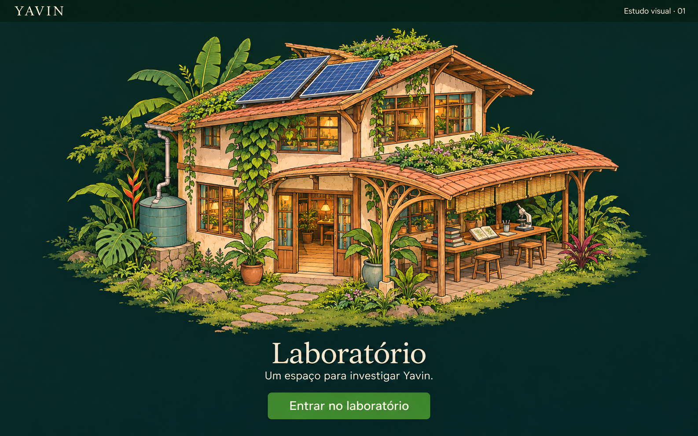

# Yavin — Estudo de entrada e laboratório, v1

**Data:** 04 de novembro de 2026  
**Estado:** proposta para validação visual, anterior à implementação do mapa.



## Objetivo

Criar uma entrada visual com apenas um lugar: o laboratório. Selecionar o edifício
ou a ação “Entrar no laboratório” deverá abrir a vista de conversa já existente.
O mapa e o laboratório serão duas vistas da mesma SPA. O painel de conversa fica
dentro do laboratório; a entrada permanece dedicada à cena.

## Direção de arte em estudo

- Composição de diorama axonométrico, com câmera fixa e edifício inteiro visível.
- Ilustração com contornos desenhados, sombras em blocos e textura pictórica seletiva.
- Uma oficina de pesquisa de escala humana, com entrada legível e varanda de trabalho.
- Madeira, reboco em tons de terra, vidro, vegetação tropical e luz interior acolhedora.
- Geração solar, água e cultivo integrados à construção como sistemas identificáveis.
- Influência Art Nouveau pontual em curvas e estruturas; caráter artesanal no conjunto.
- Interface verde muito escura; a construção recebe luz diurna e cores mais luminosas.
- Terreno pequeno com bordas integradas ao fundo, deixando espaço para expansão futura.

As referências fornecidas orientam aspectos diferentes: a primeira oferece a
composição isolada e a clareza dos volumes; a segunda, a câmera e a leitura do mapa;
a terceira, o traço ilustrado, a materialidade e a integração entre uso e vegetação.
Este estudo não define localização, implantação, dimensões ou sistemas reais de Yavin.

## Stack recomendada para o MVP

| Camada | Escolha proposta | Motivo |
|---|---|---|
| Aplicação | React + TypeScript + Vite, já presentes em `frontend/` | Reaproveitar a SPA e o painel existentes. |
| Interface | HTML semântico + CSS com variáveis | Manter a linguagem visual atual e controles acessíveis. |
| Arte do mapa | Ilustração raster; PNG durante o estudo, WebP para entrega quando adequado | Preservar o traço ilustrado sem reconstruir a arte com primitivas geométricas. |
| Interação espacial | SVG com `viewBox` para imagem e área do edifício; link HTML equivalente | Alinhar a área clicável à imagem responsiva e garantir uma entrada por teclado e toque. |
| Navegação | Duas vistas com hash, `#/mapa` e `#/laboratorio` | Permitir links diretos e voltar/avançar sem exigir configuração de rotas no servidor estático. |
| Estado | Estado React e persistência local já existentes | Suficiente para seleção de conversas e rascunhos nesta fase. |
| Movimento | Transições CSS discretas de foco e hover | Comunicar interação, respeitando preferência por movimento reduzido. |

O efeito 2.5D vem da perspectiva da ilustração. O MVP não precisa calcular uma cena
tridimensional. Canvas, WebGL, Three.js, PixiJS e engines de jogos só devem ser
avaliados se aparecerem necessidades como câmera livre, muitas entidades ou simulação.
Também não é necessário introduzir biblioteca de estado, roteador ou um novo kit de UI
para estas duas vistas.

Documentação consultada: [Vite](https://vite.dev/guide/) e
[SVG — MDN](https://developer.mozilla.org/en-US/docs/Web/SVG).

## Organização futura sugerida

```text
App
├── Entrada / MapView
│   ├── Ilustração do laboratório
│   └── Link de entrada, área clicável e rótulo
└── Laboratório / LaboratoryView
    ├── Retorno ao mapa
    ├── Área de trabalho reservada
    └── ConversationPanel existente
```

## Como avaliar o sketch

1. O edifício é reconhecível e convidativo, mesmo em tamanho reduzido?
2. O desenho e a paleta representam a identidade desejada para Yavin?
3. A entrada fica clara sem depender de texto dentro da ilustração?
4. Os elementos ambientais parecem fazer parte do uso do lugar?
5. A cena deixa espaço para outros lugares sem pressupor uma cidade pronta?

Após a validação, produzir a arte do edifício e do terreno separada da interface.
Os textos e botões do sketch são uma intenção de composição; na implementação serão
HTML/SVG acessíveis, sem texto essencial incorporado ao bitmap. Em seguida, adicionar
as duas vistas à SPA e verificar clique, toque, teclado, retorno e responsividade.
A integração com os agentes permanece uma etapa própria.

## Geração

Estudo visual produzido com a ferramenta integrada de geração de imagens.
O prompt integral está em [laboratorio-v1.prompt.txt](laboratorio-v1.prompt.txt).
Este arquivo e o sketch registram uma proposta, sem aprovar a direção de arte ou alterar
a implementação existente.
