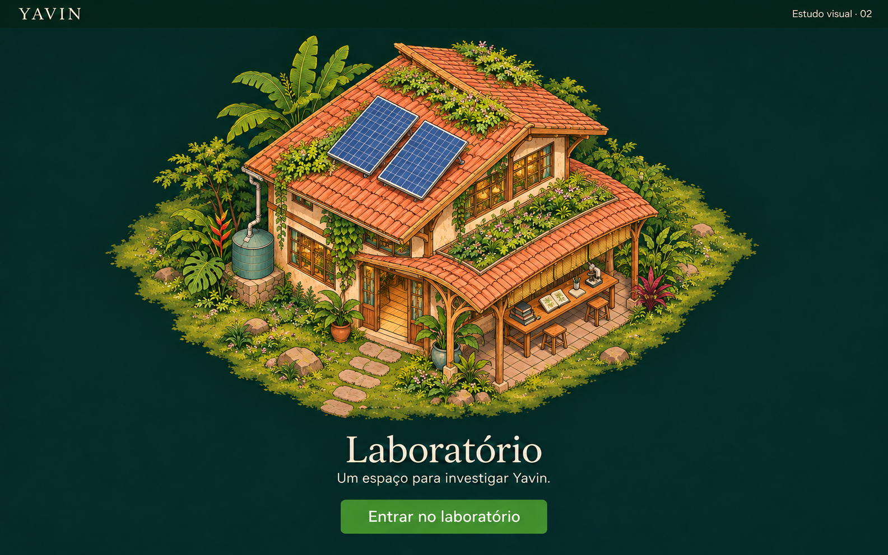

# Yavin — Estudo de câmera do laboratório, v2

**Data:** 04 de novembro de 2026  
**Estado:** proposta visual em validação; não é implementação do mapa.

## Objetivo desta revisão

Corrigir o enquadramento frontal do [primeiro estudo](laboratorio-v1.md), preservando
a linguagem ilustrada, os materiais e a identidade do laboratório.

- Câmera elevada de topo e lateral, em projeção axonométrica ortográfica.
- Telhado, duas faces do edifício e terreno claramente visíveis.
- Edifício menor no quadro, com espaço ao redor para a expansão futura do mapa.
- Vegetação e caminho de entrada acompanhando o mesmo plano de projeção.
- Sem novas construções, personagens ou mudanças de escopo na interface.

A imagem é um estudo de composição. A projeção foi solicitada à ferramenta de
geração e precisa de avaliação visual; não se trata de uma câmera 3D calibrada.
Arquitetura, proporções e detalhes continuam ajustáveis.

## O que permanece

Laboratório de dois pavimentos, madeira, reboco em tons de terra, telhas, varanda de
trabalho, vegetação tropical, painéis solares e captação de água. A entrada visual
continua separada da vista de conversa. A stack proposta no estudo v1 permanece
React + TypeScript + Vite, CSS e ilustração com área interativa em SVG.

## Geração

Revisão feita com a ferramenta integrada de geração de imagens, usando o sketch v1
como imagem de origem. O [prompt integral](laboratorio-v2.prompt.txt) registra a
correção solicitada. O primeiro estudo foi preservado para comparação.
