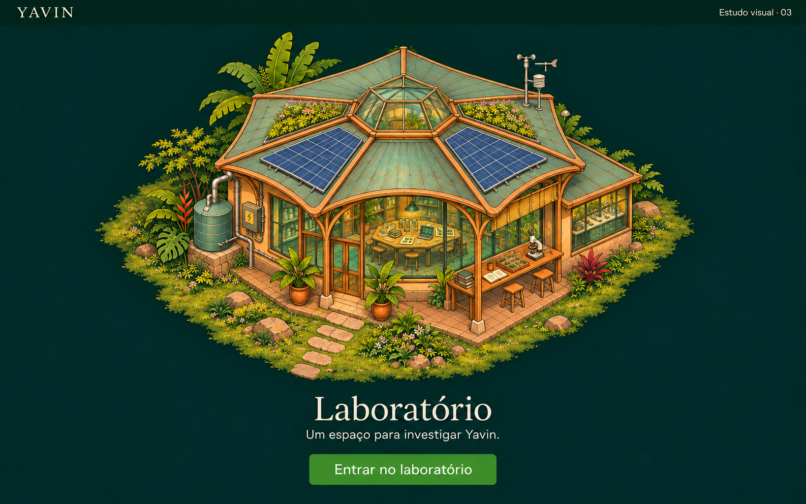

# Yavin — Estação científica, v3

**Data:** 04 de novembro de 2026  
**Estado:** primeiro modelo visual aprovado pelo Idealizador em 04 de novembro de 2026;
anterior à implementação do mapa.

## Objetivo

Explorar o laboratório como uma estação científica dedicada, com geometria
hexagonal e integração com o ambiente. Preservar a câmera elevada de topo e lateral,
o traço ilustrado e a paleta do [estudo v2](laboratorio-v2.md).

## Aprovação

O Idealizador aprovou esta versão como primeiro modelo do laboratório. Ela passa a
ser a referência visual para a estação científica: núcleo hexagonal, cobertura
facetada com claraboia, materiais artesanais, vegetação integrada e vista elevada de
topo e lateral. A aprovação estabelece uma base de trabalho; não exige reprodução
integral de cada detalhe do bitmap nem define a arquitetura real da comunidade.

## Mudança de arquitetura

- Núcleo hexagonal baixo, com cobertura facetada e entrada superior de luz.
- Geometria reconhecível na escala do mapa e possibilidade de anexos futuros.
- Varanda parcialmente aberta acompanhando as faces do núcleo.
- Entrada legível e relação clara com o caminho de acesso.
- Vidro, madeira, reboco em tons de terra e metal, com curvas orgânicas pontuais.
- Vegetação integrada sem ocultar a silhueta e os equipamentos.

## Identidade científica

A estação deve sugerir trabalho compartilhado por meio de uma mesa de investigação,
bancada com instrumentos e amostras e pequenos sistemas ambientais identificáveis.
Painéis solares e captação de água fazem parte do edifício. Os detalhes são uma
proposta de representação; não especificam infraestrutura real ou sua viabilidade.

## O que avaliar

1. O volume parece uma estação de pesquisa com identidade própria?
2. A geometria hexagonal permanece clara com a vegetação e a cobertura?
3. A câmera permite ler telhado, faces e terreno como um elemento de mapa?
4. A entrada continua evidente em tamanho reduzido?
5. A relação entre geometria, materiais artesanais e natureza é convincente?

## Limites desta entrega

O sketch não altera a SPA nem aprova uma arquitetura definitiva. A stack recomendada
permanece a do [estudo inicial](laboratorio-v1.md): React + TypeScript + Vite,
CSS e ilustração com área interativa em SVG. As versões anteriores são preservadas.

## Geração

Imagem produzida com a ferramenta integrada de geração de imagens, usando a v2 como
origem e mudando a arquitetura. O [prompt integral](laboratorio-v3.prompt.txt)
registra os elementos solicitados e as características a preservar.
