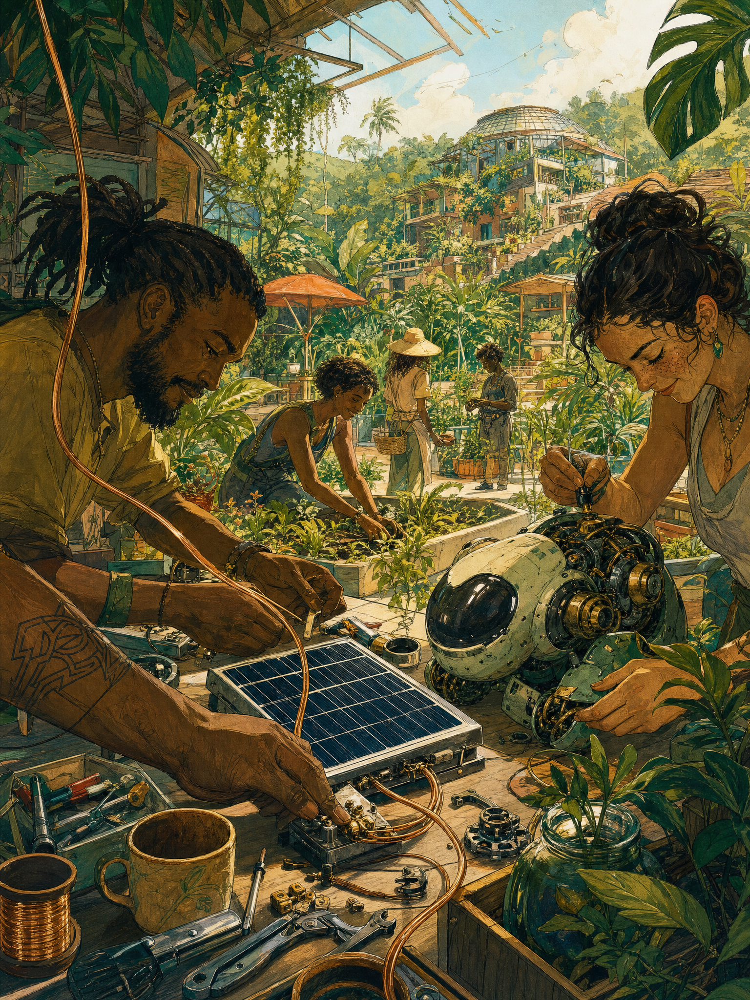

# Manifesto — página de leitura

**Natureza:** registro de implementação e proposta visual de frontend.
**Data:** 08/11/2026.
**Estado:** implementada; arte do topo aprovada pelo Idealizador como parte da identidade artística de Yavin.

Data: 08/11/2026.
Questão: disponibilizar o Manifesto Solarpunk pelo menu superior, com arte e hierarquia próprias.
Opções consideradas: texto como imagem; leitura nativa com arte editorial separada.
Decisão: texto nativo, selecionável e acessível, acompanhado de ilustração original.
Motivo: preservar conteúdo, links, destaques e leitura em diferentes telas.
O que continua aberto: refinamentos da leitura e otimização posterior de mídias.
Próximo passo: preservar esta essência nas próximas artes e evoluir a composição incrementalmente.

## Conteúdo

O componente importa `backend/src/agents/base_knowledge/manifestos/manifesto-solarpunk.md`
como texto, sem executar backend e sem modificar o documento. Não existe uma cópia
editorial independente. Os trechos em negrito, itálico, listas, links e notas são
renderizados como elementos HTML. A frase “Somos solarpunks porque as únicas outras
alternativas são a negação ou o desespero.” recebe um bloco tipográfico próprio.
O fechamento em negrito também recebe tratamento de destaque.

A identificação original como tradução de referência da biblioteca conceitual,
não manifesto autoral de Yavin, foi preservada. O link de conceitos fundamentais
disponibiliza o Markdown complementar para download.

Rota: `#/manifesto`. Link no menu superior da chegada, visita e atelier. A leitura
permanece selecionável; a restrição de seleção se aplica somente à cena de entrada.

## Arte e procedência

Arquivo: `frontend/public/images/manifesto-solarpunk-v1.png`, PNG 1536 × 2048.
[Prompt exato](arte-v1.prompt.txt).

Higgsfield foi solicitado novamente; o modelo `gpt_image_2_6` retornou
`Requires basic plan or higher.` Uma tentativa de fallback foi bloqueada pela
aprovação automática por não haver autorização específica para esse novo prompt.
Depois, o Idealizador confirmou explicitamente o uso da chave para essa arte.
A imagem foi gerada pela API OpenAI, CLI da skill `imagegen`, modelo `gpt-image-2`,
qualidade alta. Credenciais e configuração do backend não foram alteradas.

A ilustração acompanha a direção aprovada para Yavin: oficina comunitária,
trabalho manual, pequeno robô, vegetação tropical e tecnologia cotidiana.
Após visualizar a página, o Idealizador aprovou explicitamente a arte do topo e
registrou que ela consolida a identidade e direção artística desejadas. A aprovação
está preservada no [guia artístico](../direcao-artistica.md).

## Verificação

Build TypeScript/Vite e oito testes existentes aprovados. Navegador em 1440 × 960
e 390 × 844: navegação pelo menu superior, foco, carregamento da imagem, oito
elementos fortes no corpo do texto, frase principal exata, ausência de Markdown
cru ou overflow horizontal e seleção de texto preservada.
