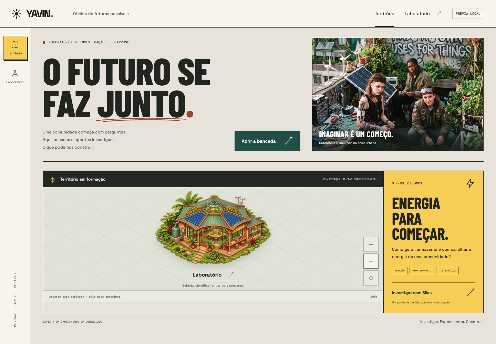
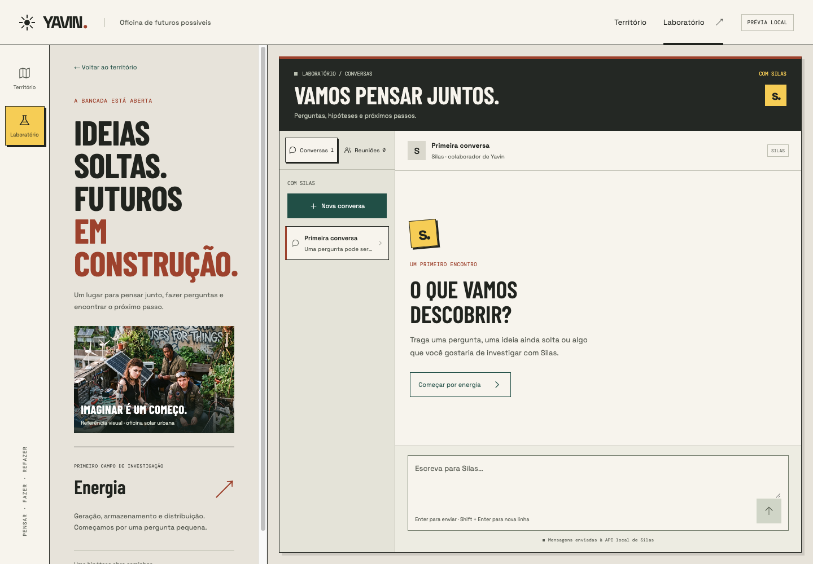
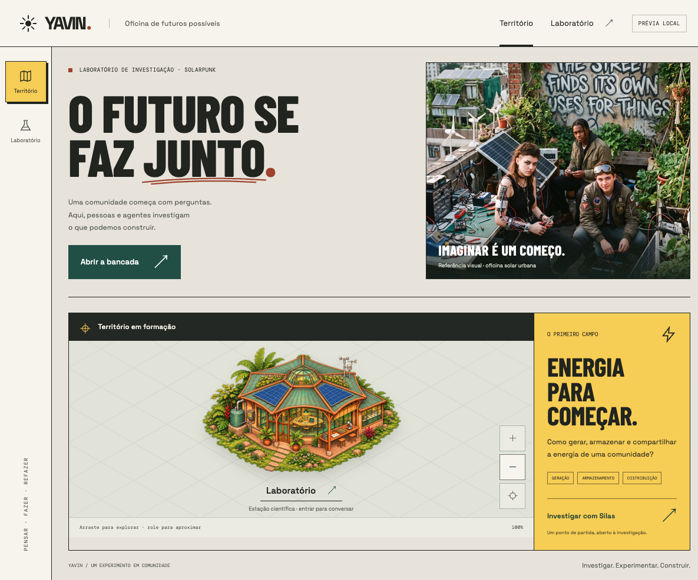
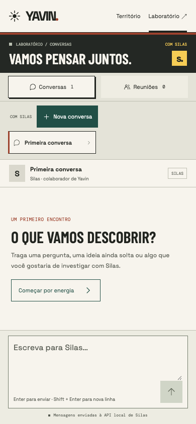
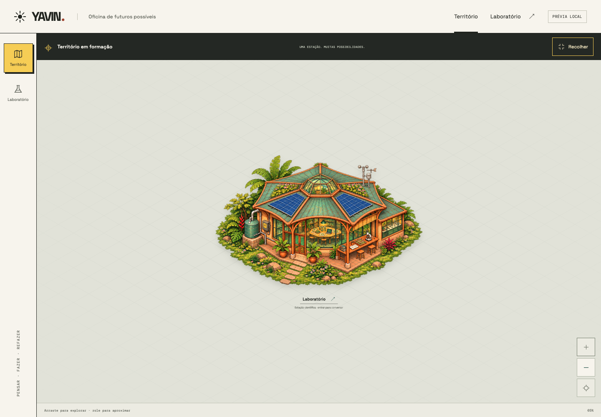
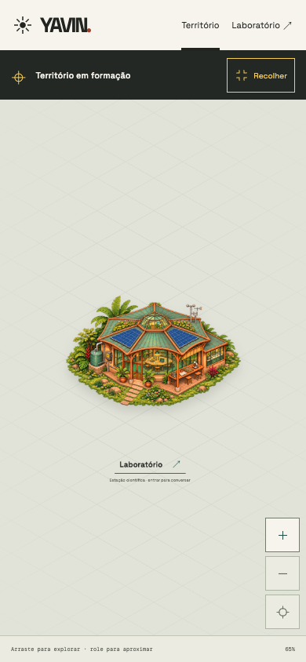

# Yavin — Segunda proposta de redesign da oficina

**Natureza:** referência visual e registro de implementação; não é decisão institucional.  
**Data:** 05 de novembro de 2026  
**Estado:** implementada e verificada; identidade avaliada positivamente pelo Idealizador, com refinamentos incrementais.

## Questão

A primeira tentativa foi rejeitada por preservar a composição anterior e concentrar
as mudanças em cores, fontes e superfícies. O [prompt e seu adendo](../../dev/project/redesign-yavin-oficina-de-futuros-prompt.md)
pedem uma mudança perceptível de identidade, hierarquia e composição.

## Opções consideradas

- Manter o mapa como fundo integral e ajustar a interface sobre ele.
- Reorganizar a entrada e a bancada em módulos com funções distintas, usando
  linguagem editorial e uma relação explícita com pessoas e ferramentas.

## Decisão de implementação provisória

Adotada a segunda opção para esta proposta, sujeita à avaliação do Idealizador.

- **Entrada:** título de grande escala, ação para abrir a bancada e referência
  humana da oficina solar urbana, seguida pelo território e pelo foco em energia.
- **Navegação:** cabeçalho e faixa lateral com as duas rotas existentes; no celular,
  navegação no cabeçalho. Sem destinos fictícios.
- **Mapa:** módulo delimitado, com cabeçalho em grafite, legenda, controles e zoom.
  Estação v3, área clicável, grid, câmera e gestos preservados.
- **Conversa:** quadro de contexto à esquerda e módulo acoplado à direita; dentro
  dele, diretório e histórico lado a lado. A leitura recebe uma superfície clara.
  No celular, diretório compacto e conversa em tela dedicada.
- **Identidade:** Barlow Condensed para títulos, Space Grotesk para conteúdo e DM Mono
  para rótulos curtos. Grafite, papel quente, cobre e amarelo; ações em verde escuro.
  Contornos, divisórias e pequenas sombras estruturam a composição.
- **Referência da laje:** cópia otimizada da imagem fornecida, identificada como
  referência visual. Não representa pessoas ou atividades reais de Yavin.

## Motivo

A composição dá presença à oficina, às pessoas e ao primeiro assunto de investigação,
enquanto mantém os acessos reais ao mapa e à conversa. A escala tipográfica e as
regiões de trabalho fazem a transformação ir além da troca de paleta.

Swadeshi e jugaad foram consultados na biblioteca conceitual como referências de
autonomia produtiva e engenhosidade com recursos disponíveis. Não foram promovidos
a princípios normativos ou requisitos técnicos novos.

## Capturas

### Entrada — desktop, 1440 px

### Bancada de conversa — desktop, 1440 px

### Entrada — celular, 390 px

### Bancada de conversa — celular, 390 px

## Validação

- `npm run build`: TypeScript e geração do bundle concluídos.
- Inspeção visual no Ego Browser em desktop e celular.
- Ausência de overflow horizontal nas duas rotas em 320 × 700, 390 × 844,
  768 × 1024 e 1440 × 1000; compositor também verificado em 390 × 500.
- Criação de conversa, sugestão editável, Enter e Shift + Enter.
- Contrato de `POST /chat`, estado de envio, resposta e falha, com respostas
  controladas no navegador, sem chamadas reais ao modelo.
- Rascunho e seleção preservados ao retornar do mapa; histórico e rascunho
  recuperados após reload.
- Reuniões: validação de participantes, deduplicação e mensagens somente locais.
- Zoom, deslocamento e centralização pelo teclado; transferência de foco ao painel.
- Dados locais usados na verificação restaurados ao estado anterior.

## O que continua aberto

- Refinamentos da composição após a avaliação positiva da identidade.
- Validação com a API e o modelo reais; continuidade de Silas entre requisições.
- Implementação de múltiplos agentes e novas ferramentas da área de trabalho.
- As fontes têm fallbacks locais, mas sua aparência preferida depende do Google Fonts.
- A janela de altura reduzida foi emulada; não houve teste em um aparelho físico
  com teclado virtual ou uma auditoria completa com leitor de tela.

## Próximo passo

Avaliar a entrada e a bancada em execução e orientar o próximo ajuste visual.
Nenhuma mudança de backend, modelo de mundo ou governança foi feita nesta entrega.

## Refinamento — mapa expandido

**Natureza:** decisão de interface solicitada pelo Idealizador.

Data: 05 de novembro de 2026  
Questão: permitir que o território ocupe toda a área de trabalho.  
Opções consideradas: manter apenas o módulo compacto ou alternar entre compacto e expandido.  
Decisão: botão Expandir/Recolher, mantendo cabeçalho e navegação lateral; Escape recolhe.
O modo expandido inicia em 65% de zoom e o normal em 100%, inclusive ao recolher.  
Motivo: explorar o mapa com mais espaço sem perder a navegação da plataforma.  
O que continua aberto: expansão do território e novas entidades.  
Próximo passo: avaliar o enquadramento durante o uso.

O mapa permanece montado durante a alternância. Os controles de zoom continuam
livres após a troca; ao visitar o laboratório e voltar, o modo expandido permanece.
A verificação cobriu expansão, recolhimento, Escape, foco, limites de zoom, acesso
ao laboratório e retorno, além de ausência de overflow em desktop, tablet,
celular e paisagem.

