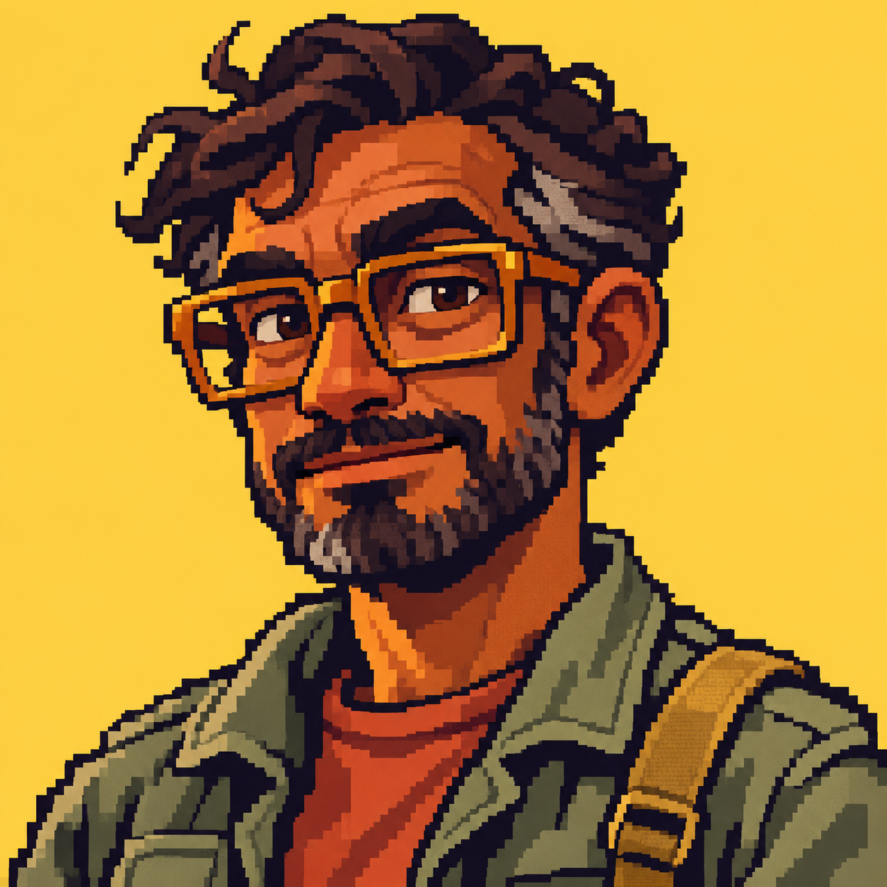
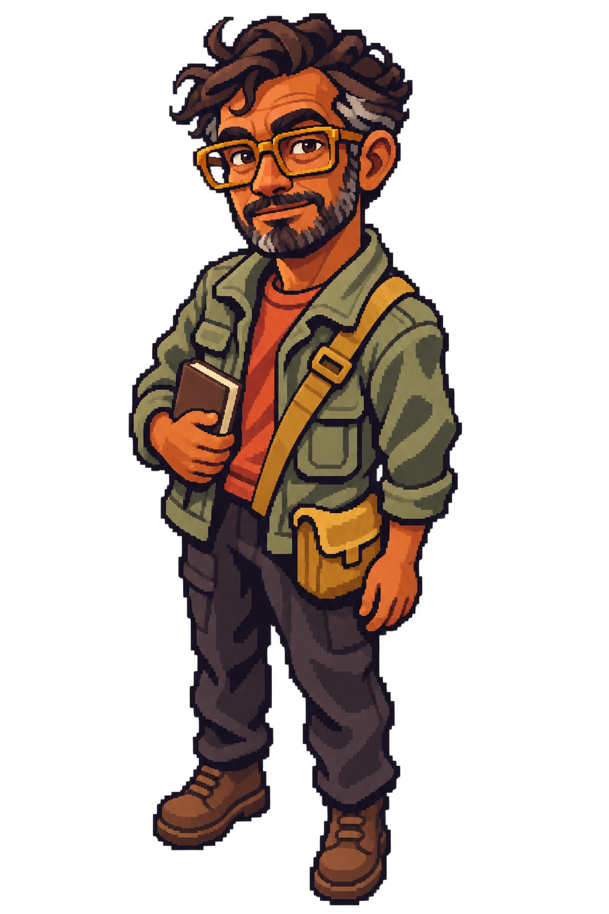
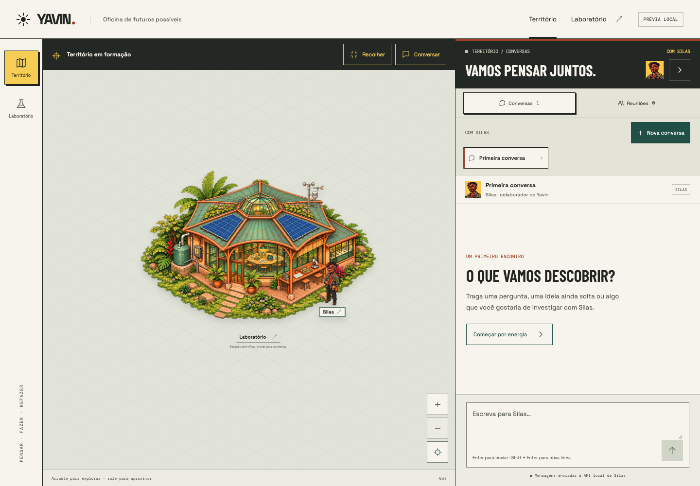
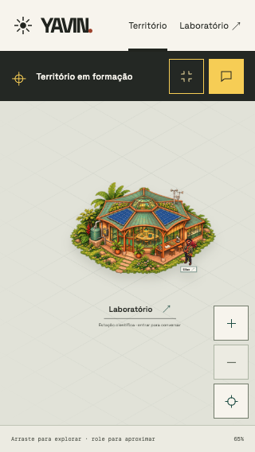

# Silas — Primeiro estudo visual

**Natureza:** referência visual e proposta de personagem; não altera a identidade documental.  
**Data:** 05 de novembro de 2026  
**Estado:** sugestão aceita pelo Idealizador e aplicações integradas à SPA em 05/11/2026.

## Pedido

Criar duas representações do mesmo Silas: avatar para substituir a marca cinza
no chat, com fundo amarelo e acabamento pixelado, e figura para uma possível
presença no mapa, cuja forma de uso permanece aberta.

## Direção proposta

A referência de estilo é o personagem ilustrado em [USUN.png](../USUN.png),
traduzido para uma caricatura adulta em pixel art, com contornos escuros,
formas angulares e sombras em blocos.

Silas é representado com pele morena, cabelo escuro ondulado com grisalho,
barba curta, óculos retangulares âmbar, jaqueta verde-oliva, camiseta terracota
e alça ocre. Essas escolhas de aparência são uma proposta artística; não foram
deduzidas como características canônicas da identidade documental do agente.

A versão de mapa foi gerada utilizando o avatar pronto como referência de
identidade, preservando rosto, cabelo, óculos, roupa e paleta.

## Avatar de chat

- PNG RGB, 1254 × 1254.
- Cabeça e ombros, com fundo amarelo solar.
- Acabamento pixelado; avatar aplicado e verificado no chat em 32–48 px.
- [Prompt integral](silas-avatar-v1.prompt.txt).

## Figura para o mapa

- PNG RGBA, 1024 × 1536, com transparência real conferida no canal alpha.
- Corpo inteiro, pose estática em três quartos, leve vista elevada.
- Mesma aparência do avatar; caderno, bolsa transversal, calça escura e botas.
- Figura estática integrada ao plano da estação, com rótulo Silas e clique que abre
  sua conversa individual no drawer. Escala inicial verificada em desktop e celular.
- [Prompt integral](silas-mapa-v1.prompt.txt).

## Produção e verificação

As duas imagens foram geradas com a ferramenta integrada `image_gen`, usando
USUN como referência de estilo no avatar e o avatar como referência de identidade
na figura. Os originais gerados foram copiados para esta pasta e preservados na
origem. Foram conferidos composição, semelhança entre as versões, dimensões e
transparência da figura de mapa. Após autorização do Idealizador, versões reduzidas
foram integradas ao frontend. O backend não foi alterado.

## Hipótese de uso no mapa

Data: 05 de novembro de 2026  
Questão: como representar Silas no território sem antecipar uma simulação espacial?  
Opções consideradas: retrato como marcador; figura estática; personagem móvel.  
Decisão: o Idealizador aceitou a sugestão de uma figura estática próxima ao
laboratório, clicável para abrir o chat existente. A aplicação foi implementada.  
Motivo: permitir avaliar identidade, escala e relação entre pessoa e estação com
uma interação pequena e reversível.  
O que continua aberto: refinamentos da câmera, escala e posição durante o uso;
eventual animação ou movimentação. A figura seleciona a conversa individual de
Silas, inclusive quando o painel estava na aba de reuniões.  
Próximo passo: avaliar as duas aplicações em uso e ajustar escala ou posição
conforme necessário.

## Aplicação e validação

Os arquivos de interface estão em `frontend/src/assets/silas-avatar.png`
(256 × 256) e `frontend/src/assets/silas-mapa.png` (512 × 768, RGBA). Os estudos
originais foram preservados. O avatar aparece no cabeçalho, na identificação da
conversa e no estado inicial; reuniões mantêm o ícone de grupo.

A figura compartilha o plano SVG da estação, acompanhando pan e zoom. Sua área de
interação usa um botão HTML, com nome acessível e ativação por teclado. Um clique
abre o drawer e seleciona a conversa individual atual ou uma conversa individual
existente; cria uma apenas se não houver nenhuma. Nenhuma chamada ao agente é
feita até o envio de uma mensagem.

Verificados build, carregamento dos retratos, clique nos mapas normal e expandido,
ativação por teclado, mudança de reuniões para conversa individual e câmera.
A figura foi conferida em telas de 1440, 390 e 320 px sem overflow horizontal.
A área clicável foi ampliada para manter um alvo de pelo menos 44 px em 320 px
com o mapa expandido no zoom mínimo.

